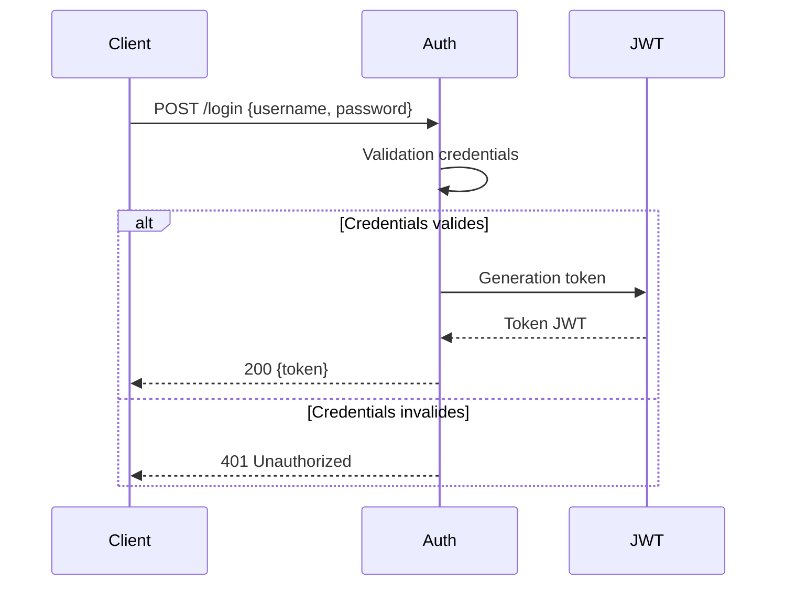
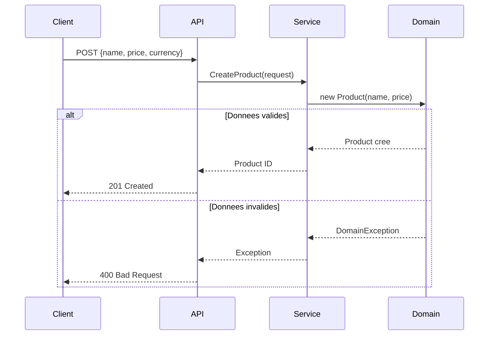
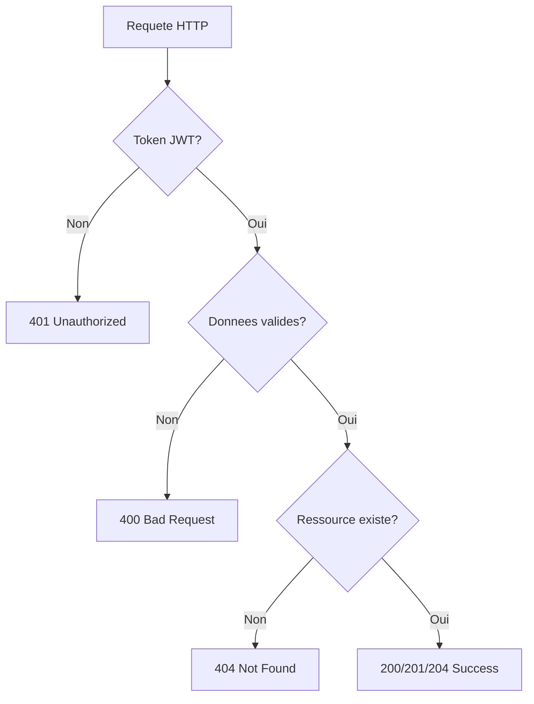

# API Reference

Documentation complete des endpoints de l'API AdvancedDevSample.

## Vue d'ensemble

```mermaid
graph LR
    subgraph Auth["Authentification"]
        Login[POST /api/auth/login]
    end
    
    subgraph Products["Produits"]
        GetAll[GET /api/products]
        GetById[GET /api/products/{id}]
        Create[POST /api/products]
        ChangePrice[PUT /api/products/{id}/price]
        Delete[DELETE /api/products/{id}]
    end
    
    Login --> |JWT Token| Products
```

---

## Authentification

### POST /api/auth/login



**Request Body:**

```json
{
  "username": "admin",
  "password": "password"
}
```

**Responses:**

| Code | Description |
|------|-------------|
| 200 | Authentification reussie, retourne le token |
| 401 | Identifiants incorrects |

---

## Produits

> **Note:** Tous les endpoints `/api/products` necessitent un token JWT valide.

### GET /api/products

Recupere la liste de tous les produits.

**Responses:**

| Code | Description |
|------|-------------|
| 200 | Liste des produits |
| 401 | Non autorise |

**Exemple de reponse:**

```json
[
  {
    "id": "3fa85f64-5717-4562-b3fc-2c963f66afa6",
    "name": "iPhone 15 Pro",
    "price": 999.99,
    "currency": "EUR",
    "isActive": true
  }
]
```

---

### GET /api/products/{id}

Recupere un produit par son identifiant.

**Path Parameters:**

| Parametre | Type | Description |
|-----------|------|-------------|
| `id` | UUID | Identifiant unique du produit |

**Responses:**

| Code | Description |
|------|-------------|
| 200 | Details du produit |
| 404 | Produit non trouve |
| 401 | Non autorise |

---

### POST /api/products



**Request Body:**

```json
{
  "name": "MacBook Pro",
  "price": 2499.99,
  "currency": "EUR"
}
```

**Responses:**

| Code | Description |
|------|-------------|
| 201 | Produit cree avec succes |
| 400 | Donnees invalides |
| 401 | Non autorise |

---

### PUT /api/products/{id}/price

Modifie le prix d'un produit existant.

**Request Body:**

```json
{
  "newPrice": 149.99
}
```

**Responses:**

| Code | Description |
|------|-------------|
| 204 | Prix modifie avec succes |
| 400 | Prix invalide |
| 404 | Produit non trouve |
| 401 | Non autorise |

---

### DELETE /api/products/{id}

Supprime un produit (soft delete).

**Responses:**

| Code | Description |
|------|-------------|
| 204 | Produit supprime |
| 401 | Non autorise |

---

## Codes d'erreur



| Code HTTP | Signification | Action recommandee |
|-----------|---------------|-------------------|
| 400 | Bad Request | Verifier les donnees envoyees |
| 401 | Unauthorized | Verifier le token JWT |
| 404 | Not Found | Verifier l'identifiant |
| 500 | Server Error | Contacter l'administrateur |

---

## Swagger UI

Pour une documentation interactive, accedez a Swagger UI une fois l'API lancee :

```
https://localhost:5001/swagger
```
