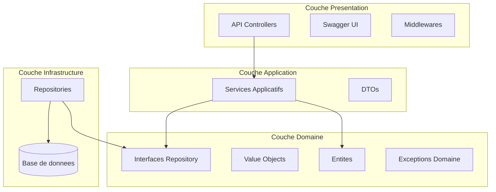
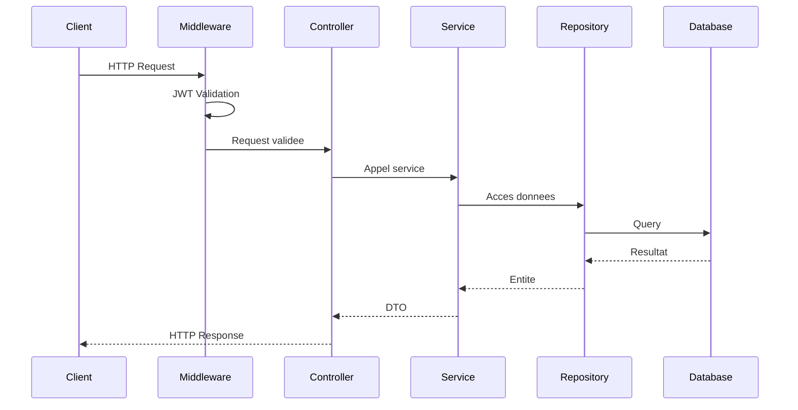
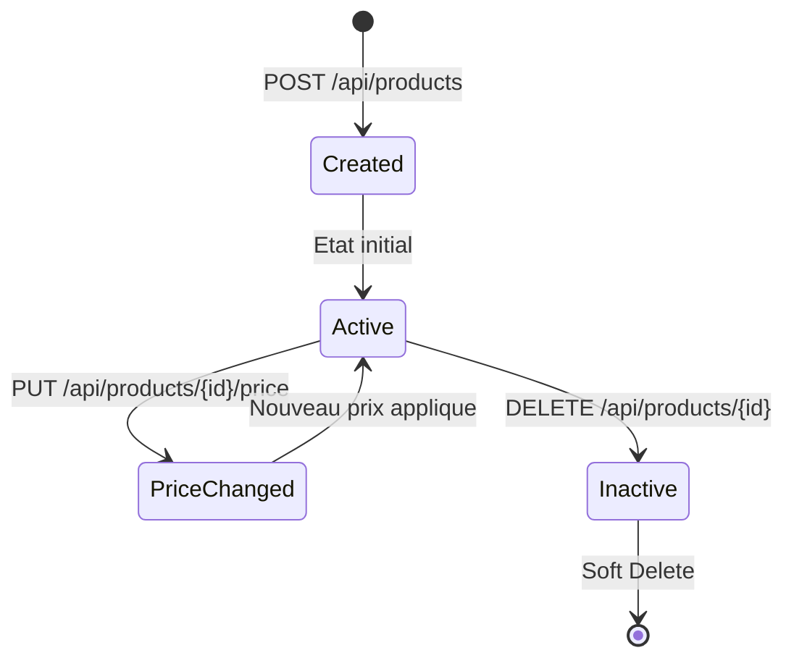
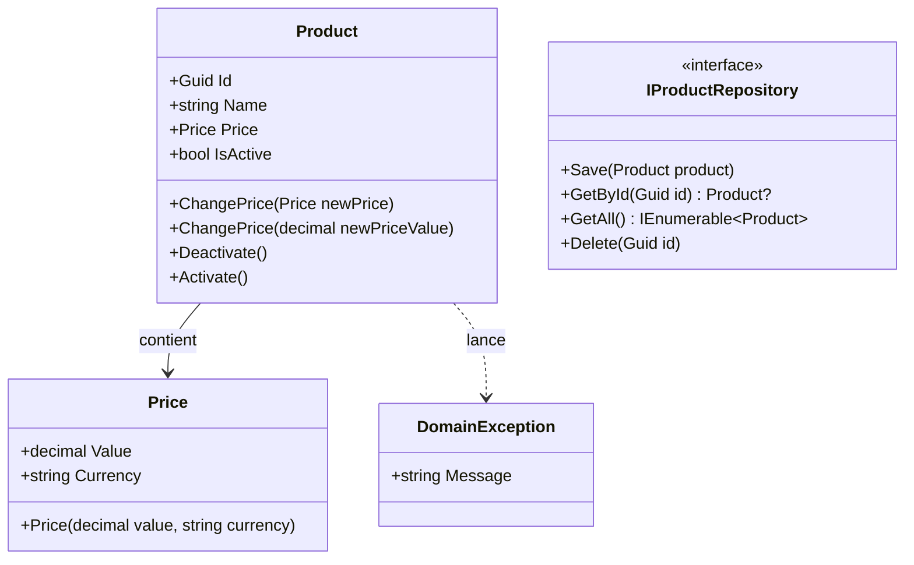
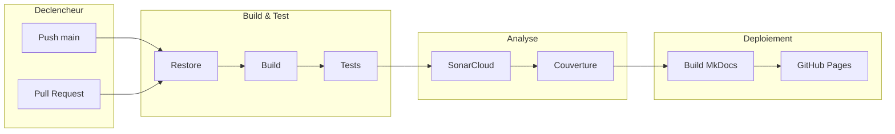

# Architecture

Vue d'ensemble de l'architecture du projet AdvancedDevSample.

## Architecture en couches

Le projet suit une **architecture hexagonale** (Clean Architecture) avec separation claire des responsabilites.



## Structure des fichiers

```
AdvancedDevSample/
|-- Api/              # Controllers, Swagger, JWT
|-- Application/      # DTOs, Services
|-- Domain/           # Entities, Value Objects
|-- Infrastructure/   # Repositories, EF Core
|-- Test/             # Unit & Integration Tests
```

---

## Flux d'une requete



---

## Cycle de vie d'un produit



---

## Diagramme de classes (Domain)



---

## Pipeline CI/CD



---

## Principes SOLID

| Principe | Description | Application |
|----------|-------------|-------------|
| **S** - Single Responsibility | Une classe = une responsabilite | `ProductService` gere uniquement les produits |
| **O** - Open/Closed | Ouvert a l'extension, ferme a la modification | Interfaces pour les repositories |
| **L** - Liskov Substitution | Les sous-types respectent les contrats | `EfProductRepository` implemente `IProductRepository` |
| **I** - Interface Segregation | Interfaces specifiques et focalisees | `IProductRepository` vs interface generique |
| **D** - Dependency Inversion | Dependre des abstractions | Injection de `IProductRepository` |

---

## Regles Clean Code

| Regle | Description |
|-------|-------------|
| Noms explicites | `GetProductById` vs `Get` |
| Fonctions courtes | Maximum 20 lignes par methode |
| Un niveau d'abstraction | Chaque fonction opere a un seul niveau |
| Pas de commentaires inutiles | Le code s'auto-documente |
| Gestion des erreurs | Exceptions specifiques au domaine |

---

## Metriques de qualite (SonarCloud)

| Metrique | Objectif |
|----------|----------|
| Couverture de code | > 80% |
| Code Smells | 0 bloquants |
| Bugs | 0 |
| Vulnerabilites | 0 |
| Dette technique | < 1 jour |
| Duplications | < 3% |
