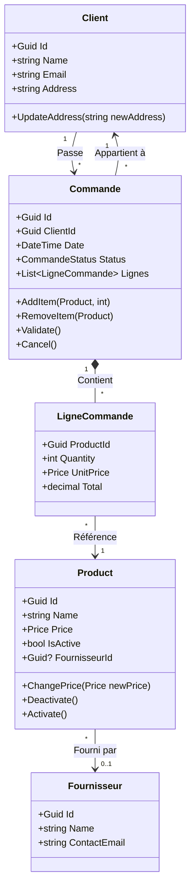

# Modèle de Domaine

Cette page décrit les entités principales du domaine et leurs relations.

## Diagramme de Classes

## Entités

### Client
Représente un client pouvant passer des commandes.
- **Propriétés** : Nom, Email, Adresse.
- **Règles** : L'email et l'adresse sont obligatoires.

### Fournisseur
Représente un fournisseur de produits.
- **Propriétés** : Nom, Email de contact.
- **Relations** : Un produit peut être lié à un fournisseur optionnel.

### Commande
Représente une transaction commerciale.
- **Cycle de vie** : `Created` -> `Validated` -> `Shipped` -> `Delivered` (ou `Cancelled`).
- **Règles** :
    - On ne peut modifier une commande que si elle est au statut `Created`.
    - Une commande doit contenir au moins une ligne pour être validée.

### Product
L'entité centrale du catalogue.
- **Nouveauté** : Ajout de la propriété `FournisseurId` pour lier un produit à son fournisseur.
