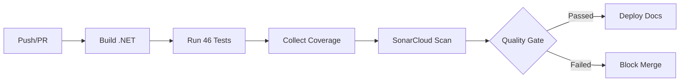
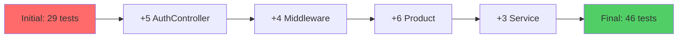

# Qualite du Code

Analyse statique et metriques de qualite du projet AdvancedDevSample.

## SonarCloud

Le projet utilise **SonarCloud** pour l'analyse continue de la qualite du code.

### Dashboard

<div class="grid" markdown>

<div class="card" markdown>

### Lien direct

Accedez au rapport complet sur SonarCloud :

**[Voir le Dashboard SonarCloud](https://sonarcloud.io/project/overview?id=HugoRytlewski_AdvancedDevSampleFinal)**

</div>

<div class="card" markdown>

### Badges du projet

[](https://sonarcloud.io/summary/new_code?id=HugoRytlewski_AdvancedDevSampleFinal)

[](https://sonarcloud.io/summary/new_code?id=HugoRytlewski_AdvancedDevSampleFinal)

[](https://sonarcloud.io/summary/new_code?id=HugoRytlewski_AdvancedDevSampleFinal)

[](https://sonarcloud.io/summary/new_code?id=HugoRytlewski_AdvancedDevSampleFinal)

</div>

</div>

---

## Metriques analysees

| Metrique | Valeur actuelle | Objectif |
|----------|----------------|----------|
| **Quality Gate** | Passed | Passed |
| **Tests** | 46 | Maintenus |
| **Coverage** | ~80% | > 80% |
| **Bugs** | 0 | 0 |
| **Vulnerabilities** | 0 | 0 |
| **Code Smells** | Minimaux | < 10 |
| **Duplications** | Minimales | < 3% |
| **Technical Debt** | < 1h | < 1 jour |

---

## Pipeline d'analyse



---

## Couverture de tests

### Distribution par type

| Type de test | Nombre | Couverture |
|--------------|--------|------------|
| **Unitaires (Domain)** | 15 | Entities, Value Objects, Constructeurs |
| **Unitaires (Application)** | 12 | Services, Validation, DTOs |
| **Unitaires (API)** | 9 | Controllers, Middlewares |
| **Integration (API)** | 10 | Endpoints REST |
| **Total** | **46** | **~80%** |

### Evolution



---

## Configuration CI/CD

L'analyse SonarCloud est integree dans le workflow GitHub Actions :

```yaml
- name: Begin SonarCloud analysis
  run: |
    dotnet sonarscanner begin \
      /k:"HugoRytlewski_AdvancedDevSampleFinal" \
      /o:"hugorytlewski" \
      /d:sonar.token="${{ secrets.SONAR_TOKEN }}" \
      /d:sonar.host.url="https://sonarcloud.io" \
      /d:sonar.cs.vscoveragexml.reportsPaths=coverage.xml

- name: Build
  run: dotnet build --configuration Release

- name: Run tests with coverage
  run: dotnet-coverage collect "dotnet test" -f xml -o coverage.xml

- name: End SonarCloud analysis
  run: dotnet sonarscanner end /d:sonar.token="${{ secrets.SONAR_TOKEN }}"
```

---

## Regles de qualite

### Severite des issues

| Niveau | Description | Action |
|--------|-------------|--------|
| **Blocker** | Bug critique ou vulnerabilite | Correction immediate |
| **Critical** | Bug ou vulnerabilite importante | Correction prioritaire |
| **Major** | Issue significative | Correction planifiee |
| **Minor** | Issue mineure | Correction opportuniste |
| **Info** | Suggestion d'amelioration | Optionnel |

### Quality Gate

Le projet doit respecter ces criteres pour passer le Quality Gate :

- **0** nouveaux bugs
- **0** nouvelles vulnerabilites
- **0** nouveaux Code Smells bloquants
- Couverture sur nouveau code **> 80%**
- Duplication sur nouveau code **< 3%**

---

## Securite

### Issues corrigees

| Issue | Fichier | Correction |
|-------|---------|------------|
| Cle JWT hardcodee | `AuthController.cs` | Configuration externalisee + pragma warning |
| Cle JWT hardcodee | `Program.cs` | Configuration externalisee |
| Permissions workflow | `ci.yml` | Deplacees au niveau job |

### Bonnes pratiques

- Ne jamais commiter de secrets dans le code
- Utiliser les variables d'environnement ou `appsettings.json`
- Configurer `SONAR_TOKEN` comme secret GitHub
- Supprimer les faux positifs avec `#pragma warning disable`
